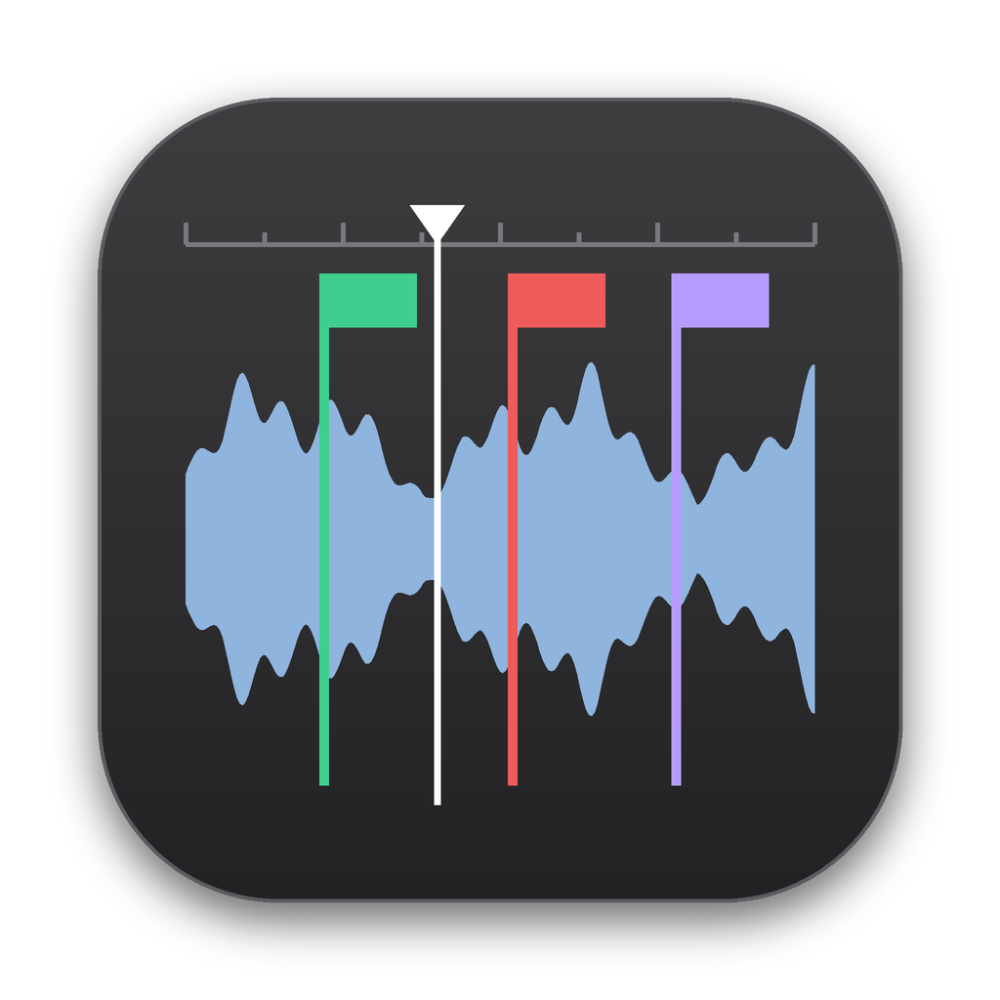
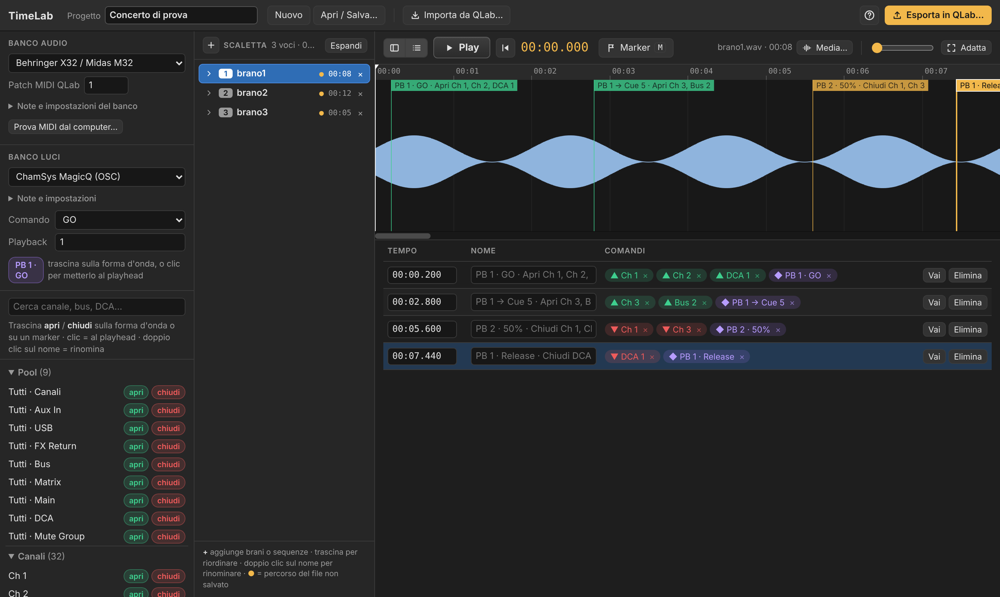

<p align="center"></p>

# TimeLab

**Programmi su una timeline i comandi del mixer audio e del banco luci, sopra la forma d'onda dei brani, e li esporti in QLab 4.**

> ⚠️ **Beta (0.9).** È provato sul campo con Yamaha QL e Midas M32, ma molti profili sono costruiti dai manuali e non sono ancora stati provati su un banco vero (vedi [Banchi supportati](#banchi-supportati)). Prova sempre lo show prima di andare in scena.



## Cosa fa

- Carichi uno o più brani (audio o video) e metti i comandi **sulla forma d'onda**, nel punto esatto in cui servono: apri e chiudi canali, bus, DCA, mute group, richiami scene, lanci cue luci.
- Con un clic esporti tutto in **QLab 4**: un gruppo per brano con l'audio (o il video) e le Start cue sincronizzate, più un **pool** di cue MIDI/OSC riutilizzabili e ordinate per categoria.
- **Cambi banco quando vuoi**: la programmazione resta e i comandi vengono tradotti per il nuovo mixer o il nuovo banco luci. Quello che sul nuovo banco non esiste resta segnato in rosso e torna valido se torni indietro.
- **Scaletta** con più brani, riordinabile; ogni brano ha i suoi marker.
- **Importa da QLab**: riapri un workspace `.qlab4` già fatto (gruppi o catene in sequenza) e ritrovi brani, ordine e comandi.
- **Video**: anteprima nella scaletta, sotto la voce del brano (anche ProRes/HAP, convertiti al volo in un proxy temporaneo), e file originale nel progetto QLab. L'audio del video si può escludere o scorporare in un file a parte.
- **LTC**: genera e aggancia una traccia di timecode per ogni brano (ora = posizione in scaletta).
- Esportazione **robusta**: aggiorna i brani già presenti senza duplicare, controlla i percorsi dei file prima di inviare, riporta gli errori brano per brano.

## Requisiti

- **macOS** con **QLab 4**. QLab 5 è previsto ma non ancora verificato.
- Un browser della famiglia Chromium: **Google Chrome**, Microsoft Edge, Brave o Chromium (l'editor si apre in una finestra dedicata).
- Per i comandi MIDI: un'interfaccia o un collegamento MIDI verso il banco, configurato come patch MIDI in QLab. Per i comandi via rete (OSC o TCP): il Mac sulla stessa rete del banco.

## Installazione

1. Scarica `TimeLab-x.y.z.zip` dall'ultima [release](../../releases) e decomprimilo.
2. Sposta **TimeLab.app** in Applicazioni.
3. La prima volta: **tasto destro sull'app › Apri › Apri**. L'app non è firmata con un Developer ID Apple, quindi macOS chiede conferma una sola volta.
4. Al primo avvio TimeLab installa **TimeLab Runner** in `~/Applicazioni`: è il piccolo programma che esegue lo script in QLab quando premi *Invia a QLab*. La prima volta macOS chiede il permesso di controllare QLab: rispondi *OK*.

### Aggiornamenti

All'avvio TimeLab controlla su GitHub se c'è una versione nuova (al massimo due volte al giorno). Se c'è, compare un riquadro con le novità e il pulsante **Aggiorna e riavvia**: TimeLab Runner scarica lo zip della release, controlla che corrisponda all'impronta SHA-256 pubblicata, che sia davvero TimeLab e della versione attesa, poi sostituisce l'app e la riapre. Se un controllo fallisce non tocca niente. La versione precedente resta in `~/.qlab-timeline-mixer/backup`.

Puoi controllare a mano dal pulsante **?** › *Controlla aggiornamenti*, oppure aggiornare scaricando lo zip e sostituendo l'app: progetti e impostazioni restano.

## Uso in breve

1. A sinistra scegli il **banco audio** e, se serve, il **banco luci**. Apri *Note e impostazioni* per sapere cosa configurare sul banco e in QLab (patch MIDI o di rete).
2. Trascina i brani nella **scaletta** (o sull'area della forma d'onda).
3. Trascina i comandi sulla forma d'onda, oppure premi **M** durante la riproduzione per mettere un marker al volo e poi aggiungi i comandi.
4. **Esporta in QLab…** › controlla il riepilogo › **Invia a QLab**. Tieni QLab aperto sul workspace giusto e non cliccare in QLab mentre lo script lavora.

Il pulsante **?** in alto a destra apre la guida completa e le scorciatoie da tastiera.

## Banchi supportati

Stato: ✅ provato su banco vero · 🟡 costruito dal protocollo ufficiale, da provare · 🧪 indirizzi non pubblicati dal costruttore, da verificare (si possono correggere nell'app)

### Audio

| Marca | Modello | Collegamento | Stato |
|---|---|---|---|
| Allen & Heath | Avantis, dLive, SQ, Qu | MIDI (NRPN) | 🟡 |
| Allen & Heath | CQ-12T / 18T / 20B | MIDI (NRPN), scene | 🟡 |
| Behringer / Midas | X32 / M32 | MIDI | ✅ M32 · 🟡 X32 |
| Behringer / Midas | X Air / MR18, Wing | MIDI | 🟡 |
| Behringer / Midas | X32 / M32, X Air / MR18, Wing | rete (OSC) | 🟡 |
| DiGiCo | SD / Quantum, S21 / S31 | rete (OSC), snapshot | 🧪 |
| Midas | PRO series, Heritage-D HD96 | MIDI, tabella CC compilata da te | 🟡 |
| Yamaha | CL / QL / TF / DM | MIDI, tabella CC + scene | ✅ QL · 🟡 gli altri |
| Yamaha | CL / QL | rete (TCP, senza MIDI) | ✅ QL · 🟡 CL |
| — | Personalizzato | MIDI CC, tabella libera | — |

### Luci

| Marca | Modello | Collegamento | Comandi | Stato |
|---|---|---|---|---|
| Avolites | Titan | MIDI Show Control (MIDI fisico) | GO, vai a cue, pausa | 🟡 |
| ChamSys | MagicQ | OSC | GO, vai a cue, release, pausa, livello, execute | 🟡 |
| MA Lighting | grandMA2 | MIDI Show Control | GO, vai a cue, release, pausa | 🟡 |
| MA Lighting | grandMA3 | OSC (riga di comando) | GO, vai a cue, release, pausa, livello | 🟡 |
| — | Generico MIDI Show Control | MSC | GO, vai a cue, release, pausa | 🟡 |
| — | Generico MIDI | note e CC | GO, release, livello | 🟡 |

Se provi TimeLab con uno di questi banchi, [apri una issue](../../issues) e racconta com'è andata: è il modo più utile per far diventare ✅ le righe gialle.

## Versione web

`dist/timelab-web.html` (generata da `scripts/build_web.py`) è la stessa interfaccia in una pagina singola, utile per programmare su un altro computer. Senza l'app per Mac non può inviare direttamente a QLab: copi lo script e lo esegui con Script Editor.

## Per chi sviluppa

L'editor è una singola pagina HTML/JavaScript senza dipendenze esterne; l'app per Mac è un piccolo launcher che la apre in una finestra di Chrome e installa il Runner (AppleScript).

```
src/editor.html          editor (sorgente unico; i blocchi <!--APP--> e <!--WEB--> separano app e versione web)
src/runner.applescript   TimeLab Runner: esegue gli script in QLab, controlla i file, crea i proxy video
app/                     launcher, Info.plist e icona dell'app per Mac
scripts/package.sh       crea dist/TimeLab.app e dist/TimeLab-<versione>.zip
scripts/build_web.py     crea la versione web
tests/smoke.py           test automatico (Playwright)
```

```bash
bash scripts/package.sh                                   # app + zip in dist/
pip install playwright && python3 -m playwright install chromium
python3 tests/smoke.py                                    # test
```

La versione sta nel file `VERSION`; le modifiche sono in [CHANGELOG.md](CHANGELOG.md). Come si pubblica una nuova versione: [docs/RILASCIO.md](docs/RILASCIO.md).

## Autori

- **[bonimattiazano-dotcom](https://github.com/bonimattiazano-dotcom)**: idea, progetto, prove sul campo.
- **Claude** ([Anthropic](https://www.anthropic.com)): sviluppo del codice, scritto insieme in conversazione.

## Licenza

[GPL-3.0](LICENSE). Puoi usare, studiare, modificare e ridistribuire TimeLab; se ridistribuisci una versione modificata, anche il suo codice deve restare aperto con la stessa licenza.

QLab è un marchio di Figure 53, LLC. TimeLab è un progetto indipendente, non affiliato né approvato da Figure 53. I nomi dei banchi citati appartengono ai rispettivi proprietari.
